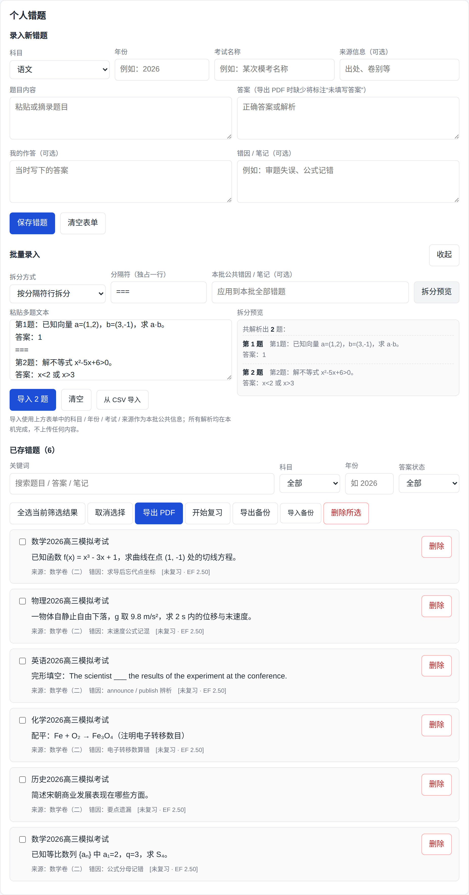
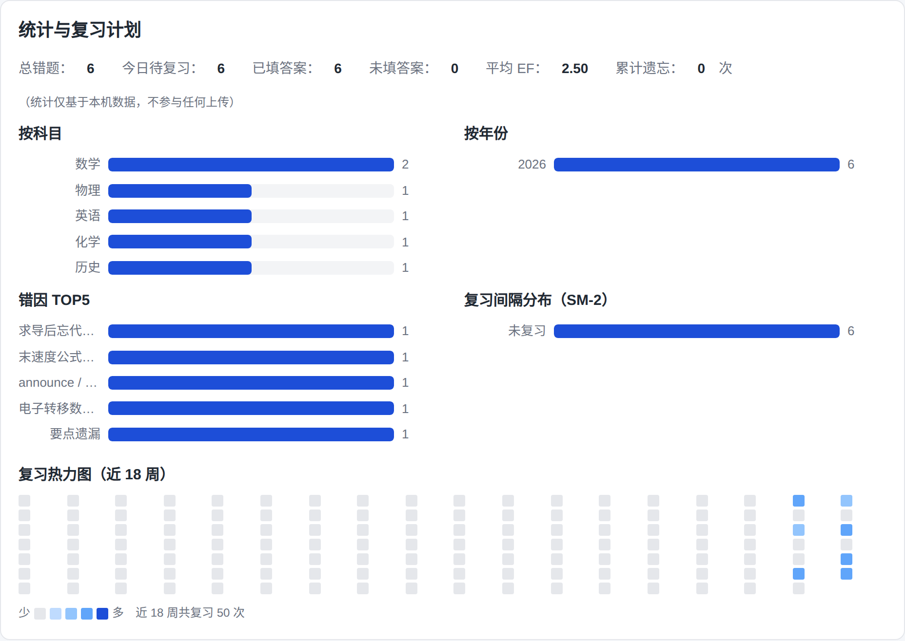

# 广东新高考模考错题溯源器

一款可直接在浏览器中使用的广东新高考模考错题溯源器（**Web 版单文件**）。年度高考题和模考题随页面文件一同打包，打开后即可离线检索；支持个人错题管理、错题与答案的 PDF 导出，以及可选的 AI 问答。

**在线使用**：https://uahz.github.io/gaokao-error-tracer/
**开发进度**：见 [ROADMAP.md](ROADMAP.md)（随每个版本发布同步更新）

## 界面预览

**个人错题管理**——录入、批量导入（预览确认）、多条件筛选，每题显示 SM-2 复习计划：

**统计与复习计划**——概览指标、按科目 / 年份 / 错因分布、SM-2 复习间隔分布与近 18 周复习热力图：

## 功能

- **内置题库（公开真题，覆盖九科）**：随页面打包 31 道经**双源交叉核对**的公开真题，覆盖语文、数学、英语、物理、化学、生物、历史、思想政治、地理全部九科，离线可检索，每道题保留年份、科目、考试名称和来源信息——2024/2025 高考新课标Ⅰ卷（数学生物化）、2025 广州一模数学、2025 广东省选考六科（物化生史政地）；收录原则为"题干与答案在两个独立来源一致 + 人工验算复核"，少数来源缺失原文的题目（如英语语法填空语篇）仅收录已核验的答案与考点并明确标注，绝不虚构原文。题库不会自动更新，新增题目须发布新版页面。
- **个人错题管理**：录入错题（科目 / 年份 / 考试 / 来源 / 题目 / 答案 / 我的作答 / 错因），支持关键词 + 科目 + 年份 + 答案状态的**多条件组合筛选**。
- **批量录入**：粘贴多题长文本，按**空行 / 分隔符行 / 题号**三种方式拆分，先预览再导入；段内以"答案："开头的行自动拆分为答案字段；也可**从 CSV / TSV 文件导入**（自动识别表头列名，支持引号转义与逗号 / 分号 / 制表符分隔，无表头按固定列序）。所有解析均在本机完成。
- **错题图片附件**：录入时可直接 **Ctrl+V 粘贴截图**或选择图片文件（每题最多 6 张，自动压缩到最长边 1600px 的 JPEG）；图片仅存本机 IndexedDB，错题列表 / 复习 / PDF 导出中都会显示，点击可放大查看；删除错题时图片同步清理；备份文件（v4 格式）包含图片，换浏览器不丢。
- **数学公式渲染**：内置 KaTeX（字体已完整嵌入，离线可用），题目和答案中的 `$...$`、`$$...$$`、`\(...\)`、`\[...\]` 会渲染为标准数学排版，错题列表、复习模式、PDF 导出与 AI 回答均支持；公式渲染只作用于纯文本节点，不引入注入风险。
- **间隔重复复习（SM-2）**：四档自评——**忘记 / 困难 / 记得 / 简单**，按 SM-2 算法计算下次复习间隔（按钮上实时显示"选这档后下次间隔"）；忘记当天重排并降低难度系数 EF，记得/简单逐次拉长间隔；支持空格与 1/2/3/4 快捷键。v1.4 及更早的 Leitner 盒子数据自动换算，无需手动迁移。
- **错题统计**：按科目 / 年份 / 错因 TOP5 / **复习间隔分布**的本地条形统计，汇总今日待复习、平均 EF、累计遗忘次数，另有近 18 周复习热力图；纯本地渲染不上传。
- **PDF 导出**：勾选错题后预览并整理成同一份文档，通过浏览器"打印 / 保存为 PDF"导出；缺少答案的题目会明确标注"未填写答案"，不会自动编造。
- **备份（带版本迁移）**：错题可导出为 JSON 备份文件（当前格式 v4，含图片），也可从任意历史版本备份（纯数组 / v2 / v3 / v4）导入合并——旧备份自动迁移为当前格式并在导入前展示转换说明，与 PDF 导出相互独立。
- **AI 问答（可选，支持多轮对话）**：填入 HTTPS 接口地址、模型名称和**你自己的 API 密钥**（DeepSeek、硅基流动、OpenRouter 等 OpenAI 兼容服务均可），即可在程序内就题目和错题提问；支持**多轮对话**——本次会话内的历史问答（最多 30 条）随每次请求一并发送，方便连续追问，点击"清空对话"或刷新页面即清空；支持 **SSE 流式输出**与"停止生成"；可主动勾选将当前题目或选中的错题附入提问，未经操作不会自动发送个人错题。密钥仅保存在当前页面会话的内存中，刷新即消失。若所用服务不允许浏览器跨域（CORS），可选用仓库 [`proxy/`](proxy/README.md) 提供的代理模板（进阶可选项，非必需）。

## 使用方式

1. 打开上方在线链接，或下载仓库中的 `index.html` 直接用浏览器打开（无需安装，可离线使用除 AI 问答外的全部功能）。
2. 错题保存在当前浏览器本地（localStorage），请定期导出 JSON 备份；清除浏览器数据会丢失错题。
3. PDF 导出使用浏览器本地打印能力，内容不经过任何服务器。

## 题库与溯源边界

- 内置题目必须有明确出处和使用权限；仅收录公开真题且满足"双源交叉核对"原则，不使用示例题或 AI 生成题冒充真题。
- 相似文字仅作为检索线索，出处必要时仍须人工核验。
- 公开网页源码不等于取得试题的再发布授权；模考卷版权归命题机构，随源码提交仅限已广泛公开、来源可核验的真题并逐题标注来源。

## 密钥与隐私

- AI 问答使用**你自己的 API 密钥**，直接在页面上填写即可使用；密钥仅保存在当前页面会话的内存中，刷新页面即消失，本页面不会把密钥写入源码、localStorage、备份、PDF 或本仓库。请仅在个人设备上使用。
- 接口必须使用 HTTPS；未经你的操作，页面不会向 AI 服务发送任何内容。
- 若所用服务不允许浏览器跨域（CORS），或需要把密钥隔离在浏览器之外，可选用 [`proxy/`](proxy/README.md) 的代理模板（进阶可选项，非必需；密钥配置在代理服务端，只写不读、不进仓库）。
- AI 问答为可选功能；未配置或服务不可用时，本地错题、题库和 PDF 导出功能照常使用。

## 开发与发布

- 仓库包含 CI 工作流（`.github/workflows/ci.yml`）：每次 push 自动做 JS 语法校验、密钥/令牌扫描和页面内容自检，防止敏感信息误提交。
- 网站由 GitHub Pages 从 main 分支自动发布。

## 许可

本项目源码按 [MIT License](LICENSE) 开源。本许可仅覆盖项目自有源代码；第三方试题内容不属于授权范围，其收录与再发布须另行取得权利人的明确授权。
